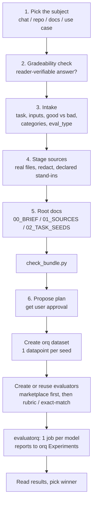

# orq build benchmark

Use when a user wants to know which model or agent is best at *their* task,
measured on *their* work. You interview them, stage real task instances with
established answers, and then build the benchmark on orq directly: an orq
dataset, orq evaluators, and a run with evaluatorq that reports to orq
Experiments. There is no third-party upload; everything lands in the user's
own orq workspace.

## At a glance

The skill turns work the team already did into a model benchmark that lives on orq:

```text
  team's real work            curated bundle            orq dataset
  ────────────────            ──────────────            ───────────
  chat / repo / docs   ──►    real task instances  ──►  1 datapoint
  tickets / orq Traces        + redacted stand-ins      per seed,
  (what actually shipped)     + root docs, checked       expected answer
                                    │
                                    ▼
                           benchmark design
                           (you propose, user approves)
                                    │
                                    ▼
                               graded run
                               (fixed answer:
                               rubric / exact-match)
                                    │
                                    ▼
                               evaluatorq run
                               1 job per model
                                    │
                                    ▼
                               orq Experiments
                               (per-category scores)
                                    │
                                    ▼
                       read results, pick the winner
```

The detailed step diagram is under [The flow](#the-flow).

Steps 1 to 5 (pick the subject, check gradeability, intake, stage sources, write
the root docs) are where most of the value is. In step 6 you design the benchmark
yourself (with user approval) and build it on orq.

## The flow



## Rules

- If the request names no subject, ask one question first and nothing else.
  When you are already in the user's repo, offer it as an option rather than
  asking to be pointed at one. When this conversation contains real work, name
  it and offer it as the default: "Want the benchmark built from what we did
  in this chat (the actual work)? Or from this repo, a folder of documents or
  tickets you point me at, or a use case you describe?"
- Give the benchmark concrete material: real instances paired with the outputs
  that were accepted, established answers with their evidence, and the mistakes
  people actually make. The benchmark can only be as specific as what you stage.
- Never upload or commit uncleared confidential material. Replace confidential
  documents with generated stand-ins that keep the real structure, field names,
  length, and messiness, and declare every stand-in in the manifest.
- Never name a file you did not create. If you generate a stand-in, write the
  actual file.
- You design the benchmark for now (task count, categories, rubric), but you do
  not finalize it silently. Show the plan and get approval before building on orq.

## What the grader can check

The grader is an orq evaluator. It reads the answer; it never executes it. A use
case only works if a fixed right answer can be verified by reading. Check this
before staging anything. If it fails, say so and propose the nearest gradeable
reformulation.

Two things fail it:

- Anything graded by execution ("passes the test suite", "returns the right
  rows") has to be restated toward what reading can verify, with a note on what
  is no longer measured.
- Anything needing bespoke tools or systems (an internal API, a live database)
  has to be restated around supplied files.

An answer that moves over time is not gradeable ("what is the share price
today"). An answer that is fixed once the inputs are attached is fine
("summarise this filing" when you attach the filing and grade against it).
File-producing work is fine: a task whose answer is a spreadsheet, a document,
or code files is a normal `agentic` task, graded by a rubric judge reading the
produced artifact.

## Intake

Pin down:

1. The work: what the org does, and the one repeating task worth measuring.
2. The inputs: what a real instance arrives with, in which formats, roughly how long.
3. Good vs bad in the user's words, as concrete observations ("reviewers reject
   answers that miss the auto-renewal clause"). These become rubric criteria, so
   prefer specific and evidenced over general.
4. The answer shape: a short written answer, a filled document, a label from a
   fixed set (get the exact set), or a produced file.
5. Categories: the 2 or more meaningfully different kinds of this work.
6. Scale and confidentiality: how many tasks, and which material cannot be used as-is.
7. The evaluation type, agreed with the user:
   - `qa`: every answer is plain text with no attached inputs.
   - `document_input`: every answer is plain text about attached files.
   - `agentic`: any task's required output is anything other than plain text in a
     reply (a spreadsheet, a document, a slide deck, code files, any produced file).
   When in doubt, `qa`: it is the easiest to grade, and `agentic` is the hardest.
   Record the type; it drives how the dataset and evaluators are built below.

When working from a repo or chat, name the repeating unit of work ("review one
pull request", not "do what this conversation did"). Find more instances of that
unit in history and files; each becomes a task. Follow-up fixes are especially
useful: each points at the change that introduced a defect, so it gives you an
instance and its correct answer together. Include instances where the right
answer is "nothing to report"; without clean inputs the benchmark cannot
penalize invented findings.

## Stage the sources

Stage into a working directory (default `benchmark_bundle/`):

- Use real files where possible. Redact rather than fabricate when redaction is enough.
- Generate stand-ins for what cannot go. Write the actual file with code; never
  name a file you did not create. Keep the stand-in as long and messy as the real thing.
- Every filename says what the file is: `supplier_contract_signed_2024.pdf`, not `doc1.pdf`.
- Group into folders by kind: `contracts/`, `claims/`, `examples/`.
- Put worked examples in `examples/`: a past input paired with the output a senior
  person actually produced.
- Put outcome evidence in its own folder: follow-up fixes, post-mortems, reviewer
  rejections. These record what the right answer turned out to be without being
  answers themselves. Say in the manifest what each item is evidence of, and use
  it for grading, never as task input.
- Do the task yourself where the answer is checkable: compute the figure, find the
  clause, assign the label. Record the result in `02_TASK_SEEDS.md` with its evidence.

## Root documents

Three files at the bundle root. Numeric prefixes make them sort first.

`00_BRIEF.md` describes the work, not the benchmark. Drop empty sections rather
than padding them:

```markdown
# <What the org does, in a sentence>

## The task we want measured
<The repeating job: what arrives, what has to come out, what makes it hard.>

## What's attached
<The bundle at folder level: what is real, redacted, or generated, and why.>

## What a good answer looks like
<Concrete and evidenced, in the org's own words.>

## What a weak answer looks like
<Mistakes actually seen. "Misses the auto-renewal clause because it sits under
Termination" beats "incomplete analysis".>

## How this work divides
<The categories.>

## The shape of an answer
<Written answer / filled document / label from the exact fixed set / file.>

## Scale
<How many tasks.>
```

`01_SOURCES.md` is the manifest. One entry per file: path, what it is, provenance
(real, redacted, or generated), and what to notice about it. Where a file
establishes a right answer, cross-reference its entry in `02_TASK_SEEDS.md`.

`02_TASK_SEEDS.md` has one entry per candidate instance of the work:

- input files (bundle paths);
- the established answer or accepted output, or a pointer into `examples/`;
- the evidence, quoted or located exactly: `adjusted balance is $842,317.44
  (Reconciliation!D48 in claims/ledger_q4.xlsx)`;
- wrong answers seen, or plausible near-misses worth penalizing;
- the category.

State facts with evidence, not scoring scales. Include the clean instances where
the right answer is "nothing to report".

## Validate the bundle

Before building on orq, run the checker next to this file on the staged directory:

```bash
python <this skill's directory>/scripts/check_bundle.py <bundle-dir>
```

It confirms the three root docs are present, that `02_TASK_SEEDS.md` has seeds,
that filenames are self-describing, that no file is too large to ingest cleanly,
and it flags common uncleared-confidential markers so nothing private slips in.
Exit 0 means shippable (warnings may still print); exit 1 means fix first (including
a path that is not a directory); exit 2 means wrong usage (you did not pass exactly
one argument).

Also confirm by eye: every filename self-describing; provenance stated for every
file; nothing confidential the user has not cleared; every known answer in
`02_TASK_SEEDS.md` with its evidence; every input the brief names is in the
bundle, or the brief says the task was restated without it.

## Build on orq

Do it in order.

### 1. Propose the plan and get approval

From the seeds, propose: the task count, the categories, the grading rubric
(criteria drawn verbatim from the "good vs bad" observations in intake), and the
model-call budget so the user approves with the cost in view. For fixed label sets,
name exact-match as the grader. State the call count explicitly: about
`datapoints x candidates` candidate calls plus one judge call each. Show this to the
user and get approval before creating anything. Do not create orq objects until they say yes.

### 2. Create the orq dataset

One datapoint per task seed. Use the orq MCP tools (`create_dataset` then
`create_datapoints`) or the orq CLI.

- `inputs`: the task input. For `qa`, the question text. For `document_input`,
  the question plus the attached file content (or a reference the job can load).
  For `agentic`, the instruction plus any input files. The step 4 template
  assumes this example dataset has a single input column named `text` and so read
  `dp.inputs['text']`; if you name the column differently, change that key to match.
- `expected_output`: the established answer from the seed. For `agentic`
  file-producing tasks, put the acceptance criteria or a pointer to the accepted
  artifact here; the rubric judge grades the produced file against it.
- `metadata`: `category`, `evidence` (the exact quote or cell reference), and
  `eval_type`.

### 3. Create or reuse the evaluators

Check the marketplace first, then fill the gaps.

- Reuse from the marketplace. Search existing workspace evaluators with
  `search_entities` (type `evaluator`), or list them over the API at
  `GET /v2/evaluators`. A built-in function evaluator (for example
  `orq_pii_detection`, `valid_json`, `orq_harmful_moderation`) attaches with no
  configuration. A hub LLM-judge or Ragas template needs configuration, so it must
  be imported into the workspace first, which makes it an evaluator entity (under
  `/v2/evaluators`) you can then attach by id. Prefer reusing a marketplace evaluator over writing a new one
  when it fits the criteria.
- Rubric judge, when no marketplace evaluator fits: an LLM evaluator whose criteria
  are the "good vs bad" observations. Build it with `create_llm_eval` (orq MCP) or
  evaluatorq's `llm_jury` at run time. (The `orq-build-evaluator` skill in this same
  plugin set builds a judge with its own approval gates; reach for it when you want
  that flow instead of hand-writing the rubric here.)
- Exact-match for fixed label sets: the built-in `exact_match` evaluator (orq), or
  evaluatorq's `exact_match_evaluator()`.

### 4. Run the candidates with evaluatorq

The template below needs a recent evaluatorq build that exports `evaluatorq`, `job`,
`llm_jury`, `exact_match_evaluator`, and `DatasetIdInput`. Install the current package
from `orq-ai/evaluatorq` (`uv add "evaluatorq @ git+https://github.com/orq-ai/evaluatorq"`,
or a published release once available). The older evaluatorq bundled in `orqkit` does
not export all of these, so a template run fails at import against it. Confirm with
`python -c "import evaluatorq; evaluatorq.llm_jury"` before running.

One `evaluatorq()` call, one job per candidate
model or agent, evaluated on the dataset. Results upload to orq Experiments when
`ORQ_API_KEY` is set. Template, grounded in the current evaluatorq API:

```python
import asyncio
from evaluatorq import DatasetIdInput, evaluatorq, exact_match_evaluator, job, llm_jury

CANDIDATES = ['openai/gpt-5', 'anthropic/claude-opus-4-1', 'google-ai/gemini-2.5-pro']

def make_job(model: str):
    @job(model)
    async def run(dp, _i):
        # call_model: define this yourself. Invoke the candidate on the datapoint
        # input via your orq client / invoke_model and return its text output; keep
        # every candidate identical except the model id. This example dataset uses a
        # single 'text' input column (see step 2), so dp.inputs['text'] is the prompt.
        # For an `agentic` task, return the produced file's text: the judge only reads
        # what this returns.
        return await call_model(model, dp.inputs['text'])
    return run

rubric = llm_jury(
    name='task-rubric',
    criteria=(
        'Score the answer against these criteria drawn from the team\'s own review notes:\n'
        '- <criterion 1 from intake>\n- <criterion 2 from intake>\n...'
    ),
    verdict_kind='numeric',
    # Required: a numeric classify judge errors without these. The score runs 0 to 1, and
    # these are its anchors, lowest first. Write them from the intake's good vs bad notes.
    levels=[
        '<what a rejected answer looks like>',
        '<what a usable answer that needs edits looks like>',
        '<what an answer the team would ship as is looks like>',
    ],
    # The judge must NOT be one of CANDIDATES. A model scoring its own answer self-prefers
    # and inflates its grade, and nothing downstream guards against it. Pick a strong model
    # that is not under test.
    model='<judge_model_not_in_CANDIDATES>',
)

async def main():
    results = await evaluatorq(
        'our-task-benchmark',
        data=DatasetIdInput(dataset_id='<orq_dataset_id>'),
        jobs=[make_job(m) for m in CANDIDATES],
        evaluators=[rubric],            # add exact_match_evaluator() for fixed-label tasks
        description='Which model is best at <our task>',
    )
    # Step 5 reads these. Print them before reporting anything.
    print({model: {**row, 'scored': len(row['scored'])} for model, row in rubric_scores(results).items()})

asyncio.run(main())
```

Every job runs against every datapoint, so each candidate is one column. Verify
the candidate model ids against `list_models` (orq MCP) before running; do not
invent model ids.

### 5. Read the results

A run can report success while every rubric score errored, so read the results that
`evaluatorq()` returns. `rubric_scores` gives each candidate's scored, errored and
skipped counts, and `paired_gap` compares two candidates on the datapoints both scored:

```python
import math
import statistics


def rubric_scores(results, evaluator='task-rubric'):
    """Per candidate: scores by datapoint, plus how many errored or were skipped."""
    table = {}
    for index, point in enumerate(results):
        for job in point.job_results or []:
            row = table.setdefault(job.job_name, {'scored': {}, 'errored': 0, 'skipped': 0})
            score = next((s for s in job.evaluator_scores or [] if s.evaluator_name == evaluator), None)
            if job.error or (score is not None and score.error):
                row['errored'] += 1
            elif score is not None:
                row['scored'][index] = float(score.score.value)
    for row in table.values():
        row['skipped'] = len(results) - len(row['scored']) - row['errored']
    return table


def paired_gap(a, b):
    """Mean of a minus b on shared datapoints, and its standard error. None under two."""
    diffs = [a['scored'][i] - b['scored'][i] for i in a['scored'] if i in b['scored']]
    if len(diffs) < 2:
        return None
    return statistics.mean(diffs), statistics.stdev(diffs) / math.sqrt(len(diffs))
```

If a whole evaluator errored, fix it and rerun.

Open the run in orq Experiments (the call prints the experiment URL) and compare
candidates per category, not just overall. Next to each score, report that candidate's
scored, errored and skipped counts from `rubric_scores`.

Report the winner with its margin and where it is weak, with two exceptions:

- If the counts differ between candidates, do not name a winner. A mean over fewer
  datapoints is not comparable.
- If the gap from `paired_gap` is smaller than twice its standard error, or it returns
  `None`, report those candidates as tied.

## Later: native orq experiments

Once the orq experiments API is finished (ADR-18), move step 4 to a native
experiment on the same dataset and evaluators. Nothing in steps 1 to 3 changes.

## Hard rules recap

- Never upload or commit uncleared confidential material.
- Declare every generated stand-in in `01_SOURCES.md`.
- Never name a file that was not created.
- Get user approval on the plan before creating orq objects.
- Verify every model id and evaluator against the orq platform; do not invent them.
